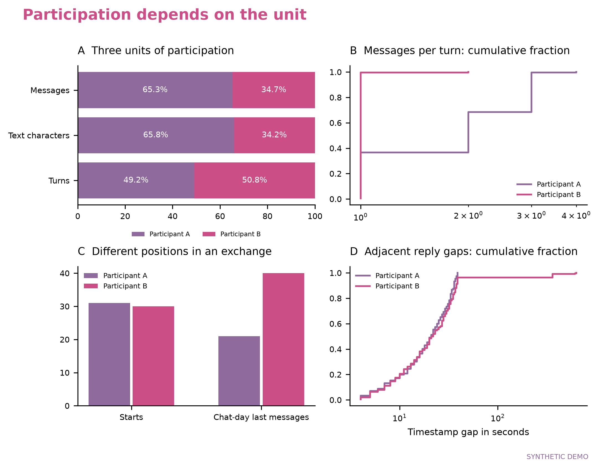

# Nature Love Toolkit

**把自有聊天导出记录，变成可复核的统计、粉色图表与中英文纪念文章。**

本地运行的 Python 工具包。输入 JSON/CSV，输出 7 组分析图、1 组个人画像、统计 JSON、中英文 HTML 与可编辑 LaTeX；安装 XeLaTeX 后可同时生成两种语言的 PDF。

仓库只包含代码、模板和**程序合成的演示记录**。没有真实情侣的聊天、附件、数据库、账户标识、密钥或实际论文。项目不上传输入，不调用在线模型，也不提供微信数据库解密功能。



## 快速开始

需要 Python 3.10 或更新版本。macOS、Linux 和 Windows 均可使用分析与 HTML 功能；PDF 另外需要 TeX Live / MacTeX。

```bash
python -m venv .venv
# macOS / Linux
source .venv/bin/activate
# Windows PowerShell: .venv\Scripts\Activate.ps1
python -m pip install .
naturelove demo --output outputs/demo
```

打开 `outputs/demo/report_zh.html` 或 `report_en.html`。图表位于 `outputs/demo/figures`，提供 PNG（300 dpi）、矢量 PDF 和 SVG。所有演示图均标注 `SYNTHETIC DEMO`。

```bash
# 安装好 XeLaTeX，且 xelatex 在 PATH 中后
naturelove demo --output outputs/demo --pdf
```

这会增加 `report_zh.pdf` 和 `report_en.pdf`。字体从 TeX Live 的 Fandol / TeX Gyre 读取，不分发本机字体文件。缺少编译器时仍保留 HTML 和 TeX 源文件。[PDF 与字体说明](docs/PDF.md)

## 使用自己的导出记录

```bash
naturelove init-config config.local.json
```

编辑配置中的两位参与者 `id`，与输入的 `sender` 精确对应；可以使用匿名别名。将个人数据放进默认忽略的 `private/`，然后运行：

```bash
naturelove run --input private/messages.json --config config.local.json --output outputs/my-report
# 需要 PDF 时在末尾添加 --pdf
```

最小 JSON：

```json
[
  {"id":"m1","timestamp":"2024-01-01T12:00:00+08:00","sender":"A","type":"text","text":"你好"},
  {"id":"m2","timestamp":"2024-01-01T12:00:08+08:00","sender":"B","type":"text","text":"你好呀"}
]
```

也接受 `{"messages":[...]}` 或同字段 CSV。**不同导出软件的原始结构不一定兼容**，请按[输入字段说明](docs/INPUT_SCHEMA.md)先转换；嵌套内容不会被静默猜测。已有清洗 CSV 的 `ts`、`datetime`、`render_type`、`voice_sec`、`call_sec` 等常见字段有别名支持。

## 分析内容

1. 总量、零记录日期、月度观察分母与连续性。
2. 星期/小时节律、个人发送时钟、午夜后占比。
3. 消息、字符和发言回合三种单位；对话起止、相邻回复间隔。
4. 词语相对使用、预指定短句、表情标识的共用情况。
5. 音视频通话提示与独立会话去重、已知时长、语音消息时长。
6. 可配置话题词典及覆盖率。
7. 内容词余弦、固定词表/等量抽样敏感性、自定义虚词匹配。
8. 独立于统计证据的个人喜好画像。

探索性情绪默认关闭；可显式设置 `exploratory_affect: true`，使用可替换的小型示例词典与日期整组重抽样。这里没有“感情分数”。[方法与解释边界](docs/METHODS.md)

## 自定义

`config.local.json` 可配置署名、共同第一作者标注、纪念日、家乡、喜好、配色、对话阈值、聊天日分界、短句和话题词典。可把 `illustration` 指向本地 PNG/JPEG；相对路径以配置文件所在目录为基准。

公开模板使用原创抽象丝带。没有捆绑第三方角色、明星照片、品牌素材、私人插画或商业字体。私人定制素材可放在 `assets/private/`，并自行确认使用权。

自动文字是由当次统计填充的**描述性初稿**。它不会复制某个案例的数字、纪念日或结论，也不会自动编造旅行、见面、共同用餐或因果机制。进一步写作可参考[论证与术语约定](docs/WRITING.md)。

## 上传 GitHub

当前交付文件夹可直接作为新仓库内容上传。添加自己的数据后，建议生成一个只含允许清单文件的新文件夹，再用网页上传：

```bash
python scripts/audit_release.py
python scripts/prepare_release.py --destination dist/github-ready
```

上传 `dist/github-ready/` **里面的内容**。浏览器拖拽上传不会自动遵守 `.gitignore`，因此不要把包含 `private/`、`outputs/` 的整个工作目录拖进去。允许清单在 `PUBLIC_FILES.json`；新增公共源码或文档时同步更新它。[发布与隐私说明](docs/PUBLISHING.md)

本工具不会替你创建 GitHub 仓库或推送代码。

## 开发与检查

```bash
python -m pip install -e '.[dev]'
python -m pytest
python -m build
python scripts/audit_release.py
```

GitHub Actions 使用合成数据检查安装、测试、演示和发布清单。实际本地验证记录见 [VALIDATION.md](VALIDATION.md)。

## 许可与来源

新实现与模板采用 [MIT License](LICENSE)。项目思路受到 [momoPaper123 的 Nature Love 工作流](https://github.com/momoPaper123/-)启发；本仓库没有重新分发该仓库的六份源码、其词典或本地第三方技能原文，详见 [NOTICE.md](NOTICE.md)。

这是社区纪念文章工具，与 Nature Portfolio 无隶属关系。
