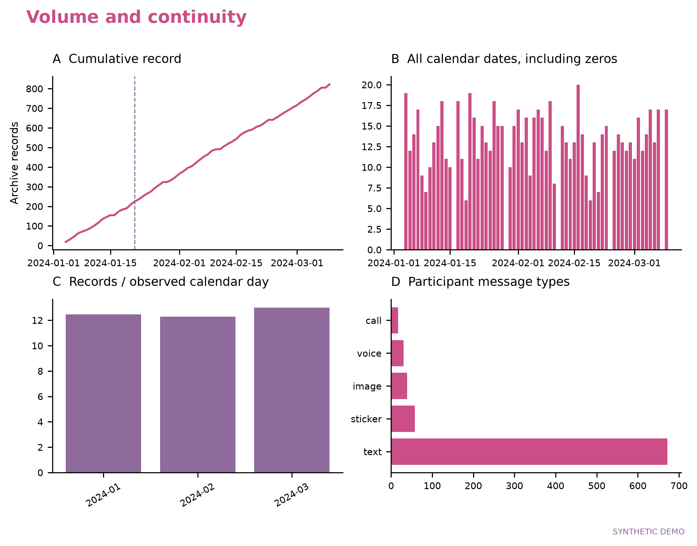
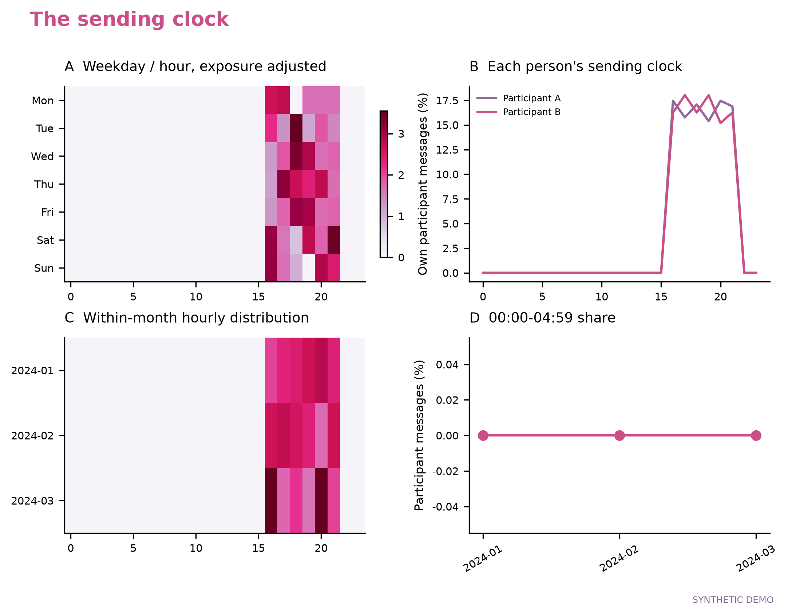
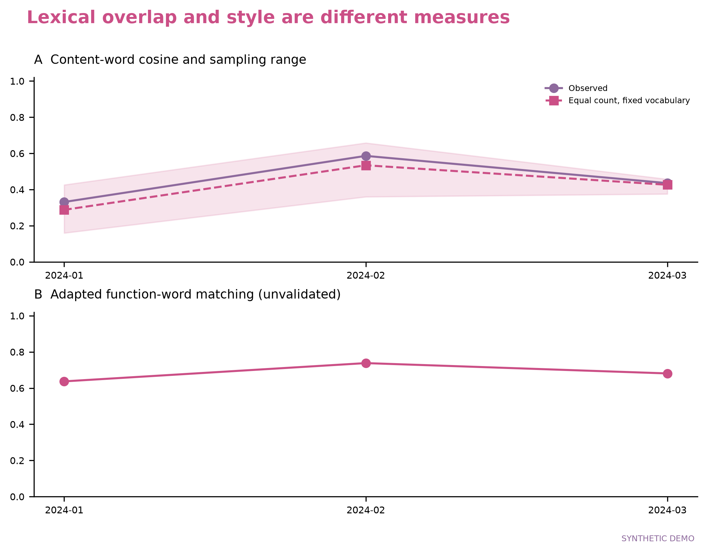

# Nature Love Toolkit

**把两个人的聊天记录，整理成可复核的统计、粉色图表与中英文纪念文章。**

Local chat analytics, pink scientific figures, and bilingual commemorative reports.

[](https://github.com/Charles-Xu0518/NatureLove-OpenSource/actions/workflows/ci.yml)

**Python 3.10+ · MIT · 本地分析 · 无需 API Key · HTML / LaTeX / PDF**

输入一份双人聊天的 **JSON / CSV**，即可生成 **7 组分析图 + 1 组个人画像**、统计 JSON，以及中英文图文报告。可以先运行合成演示，确认效果后再接入自己的记录；生成 HTML 和图表无需安装 LaTeX。

本仓库公开的记录与预览全部为**程序合成数据**。分析过程在本机完成，不上传输入，也不调用在线模型；首次安装依赖需要联网。

[效果预览](#效果预览) · [功能介绍](#功能介绍) · [安装与首次运行](#安装与首次运行) · [使用自己的聊天记录](#使用自己的聊天记录) · [生成论文-pdf](#生成论文-pdf) · [常见问题](#常见问题)

## 效果预览

以下四组图来自随项目提供的 **822 条合成演示记录**，均保留 `SYNTHETIC DEMO` 标注。点击图片可查看大图；实际分析会使用你输入的数据重新计算。

| 聊天量与连续性 | 一天中的发送时刻 |
|---|---|
| [](docs/assets/demo-overview.png) | [](docs/assets/demo-rhythm.png) |
| 观察累计量、零记录日期、月度强度与消息类型。 | 查看星期 / 小时分布、个人发送节律与午夜后占比。 |
| **消息、字符与发言回合** | **词汇重叠与虚词匹配** |
| [](docs/assets/demo-preview.png) | [](docs/assets/demo-language.png) |
| 比较不同计数单位，并查看对话起止和回复间隔分布。 | 区分内容词重叠、抽样敏感性与示例虚词指标。 |

完整运行还会生成词语表达、消息渠道、话题覆盖和个人画像图。每组图提供 **300 dpi PNG、矢量 PDF、SVG**，便于插入文章、继续编辑或打印。

## 功能介绍

| 模块 | 可以看到什么 | 对应输出 |
|---|---|---|
| 聊天量与连续性 | 总记录、双方消息、自然日、连续记录区间、日峰值与月度日均量 | Figure 1 |
| 发送节律 | 星期 / 小时热图、双方发送时钟、月度时段变化、午夜后占比 | Figure 2 |
| 互动结构 | 消息 / 字符 / 回合占比、每回合条数、对话开启与结束、相邻回复间隔 | Figure 3 |
| 语言与表达 | 词语相对使用、可配置短句、已知表情标识的共用情况 | Figure 4 |
| 文字之外的渠道 | 图片 / 视频 / 语音等类型计数、可识别独立通话、已知源时长 | Figure 5 与统计 JSON |
| 话题分布 | 自定义话题词典、每人每千条文字的命中数、整体覆盖率 | Figure 6 |
| 词汇与文风 | 月度内容词余弦、固定词表与等量抽样、八类示例虚词匹配 | Figure 7 |
| 个人画像 | 自填家乡、喜欢与不喜欢、署名、纪念日、原创抽象丝带或本地插画 | Figure 8 与报告 |

输出的中英文文章包含摘要、分节结果、图注、讨论与方法说明，数字由本次统计填充。它是**可继续编辑的描述性初稿**；个性化叙事、背景解释与正式投稿要求需要进一步整理。

适用范围是**已导出、可读取的双人聊天记录**。工具不提取数据库密钥，不从微信客户端导出历史，也不恢复、复制、播放或转写媒体附件；图片、视频、语音与表情的统计依赖输入中的消息类型和元数据。复杂导出格式需先按[输入规范](docs/INPUT_SCHEMA.md)转换。

## 安装与首次运行

### 1. 准备环境并获取项目

需要 [Python](https://www.python.org/downloads/) **3.10 或更新版本**。首次使用可选择 Python 3.12；GitHub 自动检查覆盖 3.10 与 3.12。需要克隆仓库时，先安装 [Git](https://git-scm.com/downloads)。

在终端中执行：

```bash
git clone https://github.com/Charles-Xu0518/NatureLove-OpenSource.git
cd NatureLove-OpenSource
```

也可以在仓库首页选择 **Code → Download ZIP**，解压后在该文件夹打开终端，继续下一步。后续命令均在包含 `pyproject.toml` 的项目根目录执行。

### 2. 创建环境并安装

按自己的系统选择一组命令。虚拟环境用于隔离本项目的依赖；创建与激活方式可参阅 [Python 官方说明](https://docs.python.org/3/library/venv.html)。

**macOS / Linux（bash 或 zsh）**

```bash
python3 --version
python3 -m venv .venv
source .venv/bin/activate
python -m pip install --upgrade pip
python -m pip install .
python -m naturelove --version
```

Ubuntu / Debian 若提示缺少 `venv`，先安装对应 Python 版本的 `python3-venv` 系统包，再创建环境。

**Windows（命令提示符 / CMD）**

```bat
py -3 --version
py -3 -m venv .venv
.venv\Scripts\activate.bat
python -m pip install --upgrade pip
python -m pip install .
python -m naturelove --version
```

若没有 `py` 命令，但 `python --version` 显示符合要求的版本，可用 `python` 替换上面的 `py -3`。

**Windows PowerShell（直接使用环境中的 Python）**

```powershell
py -3 -m venv .venv
.\.venv\Scripts\python.exe -m pip install --upgrade pip
.\.venv\Scripts\python.exe -m pip install .
.\.venv\Scripts\python.exe -m naturelove --version
.\.venv\Scripts\python.exe -m naturelove demo --output outputs/demo
```

PowerShell 这组命令无需激活脚本。后文命令里的 `python` 均指项目虚拟环境中的解释器；沿用此方式时，将 `python` 写成 `.\.venv\Scripts\python.exe` 即可。

安装完成后，版本命令应返回 `0.1.0`。如果重新打开终端，macOS / Linux 或 CMD 用户需重新进入项目目录并激活 `.venv`。

### 3. 先用演示数据跑通

```bash
python -m naturelove demo --output outputs/demo
```

成功后，终端会显示 `SYNTHETIC DEMO: 822 records` 和结果目录。打开 **`outputs/demo/report_zh.html`** 查看中文报告，或打开 **`report_en.html`** 查看英文报告。

可以直接在文件管理器中双击 HTML；也可以在对应系统执行：

| 系统 / 终端 | 打开中文报告 |
|---|---|
| macOS | `open outputs/demo/report_zh.html` |
| Windows CMD | `start outputs\demo\report_zh.html` |
| Windows PowerShell | `Start-Process .\outputs\demo\report_zh.html` |
| 带图形界面的 Linux | `xdg-open outputs/demo/report_zh.html` |

HTML 会读取同目录的 CSS 和相邻图表。转移报告时保留整个输出文件夹。服务器没有桌面环境时，可以把输出文件夹带到自己的电脑后打开。

### 4. 了解结果放在哪里

```text
outputs/demo/
├── summary.json          # 统计结果、分母、输入指纹和缺失信息
├── run_config.json       # 本次运行实际使用的配置
├── demo_input.json       # 仅 demo 命令额外保存的合成记录
├── report_zh.html        # 中文图文报告
├── report_en.html        # 英文图文报告
├── report.css
├── figures/
│   ├── Figure1.png       # Figure1–Figure8，每组各有 PNG / PDF / SVG
│   ├── Figure1.pdf
│   ├── Figure1.svg
│   └── ...
└── latex/
    ├── report_zh.tex     # 可编辑的中文 LaTeX
    └── report_en.tex     # 可编辑的英文 LaTeX
```

图表 PDF 总会生成；**文章 PDF** 则需要额外安装 XeLaTeX 并添加 `--pdf`，见[下面的步骤](#生成论文-pdf)。

## 使用自己的聊天记录

### 1. 准备一份标准 JSON 或 CSV

在项目根目录创建 `private` 文件夹，把自己的转换结果保存为 `private/messages.json`。不要把原始数据库直接改名为 JSON。

最小 JSON 示例（以下名字与内容均为虚构）：

```json
[
  {"id": "m1", "timestamp": "2024-01-01T12:00:00+08:00", "sender": "A", "type": "text", "text": "你好"},
  {"id": "m2", "timestamp": "2024-01-01T12:00:08+08:00", "sender": "B", "type": "text", "text": "你好呀"}
]
```

JSON 也可以是 `{"messages": [...]}`。CSV 使用同样的列名，保存为 UTF-8 / UTF-8-BOM：

```csv
id,timestamp,sender,type,text
m1,2024-01-01T12:00:00+08:00,A,text,你好
m2,2024-01-01T12:00:08+08:00,B,text,你好呀
```

| 字段 | 如何填写 |
|---|---|
| `timestamp` | 必填。推荐带时区的 ISO 时间；也支持 Unix 秒 / 毫秒 |
| `sender` | 必填。与配置中的两位参与者 `id` 精确一致，区分大小写 |
| `id` | 建议填写稳定、唯一的字符串。相同 ID 且内容一致时会去重；冲突会报错 |
| `type` | 默认 `text`。还支持 `image`、`video`、`voice`、`sticker`、`call`、`file`、`link`、`location`、`system`、`other` |
| `text` | 字符串正文；媒体消息可为空字符串 |
| `duration_seconds` | 可选的非负秒数。用于语音 / 通话已知时长统计 |
| `call_id` / `call_type` | 通话会话标识与类型。标识用于去重；类型可写 `audio` 或 `video` |
| `sticker_id` | 可选的稳定表情标识，用于比较双方共用的表情种类 |

例如，一条通话记录可以写成：

```json
{"id": "call-1", "timestamp": "2024-01-01T20:00:00+08:00", "sender": "A", "type": "call", "text": "", "call_id": "session-1", "call_type": "video", "duration_seconds": 120}
```

同一次通话的双方提示应保留相同 `call_id`；它们会归并为一次可识别会话。缺少标识的提示单独列为未识别提示，不直接当作独立通话次数；缺失或冲突的时长不会自动补齐。

支持 `ts`、`datetime`、`sender_id`、`render_type`、`voice_sec`、`call_sec` 等别名，完整对应关系见[输入字段说明](docs/INPUT_SCHEMA.md)。**复杂嵌套 JSON、XML 和特定导出软件的结构需先转换**；这里只分析输入中实际存在的记录，不验证手机历史是否完整。

### 2. 生成并修改配置

```bash
python -m naturelove init-config config.local.json
```

用文本编辑器打开 `config.local.json`，先修改双方的 `id` 与 `name`。`id` 用于匹配消息，`name` 用于报告署名；使用匿名别名也可以。纪念日不知道时保留 `null`。

也可以把下方完整的最小配置保存到该文件，未列出的选项将使用默认值：

```json
{
  "title": "Our Everyday Story",
  "timezone": "Asia/Shanghai",
  "relationship_date": "2024-01-21",
  "joint_first_authors": true,
  "participants": [
    {"id": "A", "name": "Alex", "hometown": "City A", "likes": ["摄影", "散步"], "dislikes": []},
    {"id": "B", "name": "Jamie", "hometown": "City B", "likes": ["阅读", "甜点"], "dislikes": []}
  ],
  "colors": ["#8E6A9D", "#CB4F86"],
  "exploratory_affect": false
}
```

此处日期、名字和喜好均为示例。家乡与喜好来自你的填写，不由聊天词频自动推断。

### 3. 运行自己的分析

```bash
python -m naturelove run --input private/messages.json --config config.local.json --output outputs/my-report
```

CSV 只需替换输入路径：

```bash
python -m naturelove run --input private/messages.csv --config config.local.json --output outputs/my-report-csv
```

打开 `outputs/my-report/report_zh.html` 即可查看。只有两条记录的最小示例也能运行，但月度词汇指标可能为 `NA`；这表示缺少可计算数据。

首次运行请使用空输出目录。工具会拒绝覆盖无自身标记的非空目录；重跑工具已生成的目录会更新结果，想保留旧版时换一个输出路径。

## 生成论文 PDF

**HTML、统计和图表可先独立使用；需要文章 PDF 时再安装 TeX。**

1. macOS 安装官方完整 [MacTeX](https://tug.org/mactex/)；Windows 按 [TeX Live Windows 指南](https://tug.org/texlive/windows.html)安装；Linux 可按 [TeX Live 快速安装指南](https://tug.org/texlive/quickinstall.html)安装。完整发行版较大，应预留下载时间与磁盘空间。
2. 安装后重新打开终端，重新进入项目并激活 Python 环境。
3. 执行以下检查，确认编译器和字体可被找到：

```bash
xelatex --version
kpsewhich FandolSong-Regular.otf
kpsewhich texgyretermes-regular.otf
```

然后生成演示 PDF：

```bash
python -m naturelove demo --output outputs/demo --pdf
```

或为自己的记录生成：

```bash
python -m naturelove run --input private/messages.json --config config.local.json --output outputs/my-report --pdf
```

输出目录会新增 **`report_zh.pdf`** 与 **`report_en.pdf`**。缺少编译器或编译失败时，已经生成的 HTML、图表和 TeX 仍会保留；编译失败的日志位于 `latex/compile_zh.txt` 或 `latex/compile_en.txt`。

继续编辑时，保留 `latex/` 与 `figures/` 的相对位置。字体与手工编译方法见 [PDF 说明](docs/PDF.md)。

## 自定义与结果解读

| 配置 | 用途与默认行为 |
|---|---|
| `title`、`participants`、`joint_first_authors` | 标题、双方署名和共同第一作者标注 |
| `relationship_date` | 纪念日，格式 `YYYY-MM-DD`；未确定时为 `null` |
| `timezone` | 无时区时间的解释与本地日历，默认 `Asia/Shanghai` |
| `colors` | 按双方顺序设置两个颜色 |
| `conversation_gap_hours` | 新对话的间隔阈值，默认 3 小时 |
| `day_boundary_hour` | 聊天日末条消息的日界，默认 05:00；总体日历仍用自然日 |
| `phrases`、`topics` | 自定义短句与话题词典 |
| `sample_messages`、`sampling_draws`、`seed` | 等量抽样上限、抽样次数与随机种子 |
| `illustration` | 本地 PNG / JPEG 插画；相对路径以配置文件所在目录为基准 |
| `exploratory_affect` | 默认 `false`；显式开启后提供小型示例词典的探索性统计 |

自定义插画可放在 `assets/private/`，再设置 `"illustration": "assets/private/art.png"`。默认公开模板使用本项目绘制的抽象丝带；仓库不捆绑第三方角色、明星照片或商业字体。

这些指标描述**这个导出窗口中的交流记录**。消息数、字符数与回合数回答不同问题；相邻回复间隔不等于已读后响应时间。话题提及不能直接换成共同旅行或用餐次数，语言相似度和示例情绪指标也不构成关系质量评分。缺失信息保持缺失。

进一步说明见[方法与单位](docs/METHODS.md)和[写作约定](docs/WRITING.md)。

## 常见问题

| 遇到的情况 | 处理方式 |
|---|---|
| `python` / `py` 找不到，或版本太旧 | 安装 Python 3.10+，重新打开终端；macOS / Linux 创建环境时使用 `python3` |
| `No module named naturelove` | 确认使用项目虚拟环境，并在项目根目录执行 `python -m pip install .` |
| `naturelove` 命令找不到 | 改用 `python -m naturelove`；PowerShell 可用 `.\.venv\Scripts\python.exe -m naturelove` |
| PowerShell 激活脚本被阻止 | 使用安装章节中直接调用 `.\.venv\Scripts\python.exe` 的方式，无需修改执行策略 |
| 发送者不匹配 | 对照消息的 `sender` 与配置的两个 `id`；未知非系统发送者会报错，本项目针对双人聊天 |
| JSON 无法读取、正文不是字符串 | 保存为 UTF-8，核对逗号与引号；按输入规范展开嵌套字段，不要直接传数据库或 XML |
| 相同 ID 内容冲突 | 检查上游合并或导出过程；为不同消息保留不同稳定 ID，不要直接丢弃冲突记录 |
| 输出目录提示非空 | 改用新的空目录，例如 `outputs/my-report-v2`；不要删除自己的其他文件来绕过保护 |
| 没有文章 PDF | 安装 XeLaTeX，确认字体路径，并添加 `--pdf`；已有的图表 PDF 与文章 PDF 是不同输出 |
| 图中中文显示为 `term N` | 绘图环境缺少可用中文字体；安装如 Noto CJK 的字体后重跑，原词仍保留在统计 JSON 中 |
| 部分指标为 `NA` / `null` | 检查双方文字量、月份、词表阈值与元数据；短时间或少量样本可能不足以计算 |
| 改了源码或更新仓库，运行结果却没变化 | 普通安装需要重新执行 `python -m pip install .`，再运行分析 |

查看命令帮助：

```bash
python -m naturelove --help
python -m naturelove run --help
```

## 隐私与公开发布

真实输入放在 `private/`，个人配置使用 `config.local.json`，生成结果留在 `outputs/`；这些路径已被 `.gitignore` 忽略。**统计 JSON、日期、词频和个人画像也可能包含私人信息**，不要因为没有整段原文就直接公开。

需要发布自己的工具修改时，先检查公开清单并生成一个干净的上传目录：

```bash
python scripts/audit_release.py
python scripts/prepare_release.py --destination dist/github-ready
```

只上传 `dist/github-ready/` **里面的内容**。网页拖拽上传不会自动遵守 `.gitignore`；检查脚本只能识别部分敏感模式，仍需阅读准备公开的内容。新增公共文件时同步 `PUBLIC_FILES.json`，详情见[发布说明](docs/PUBLISHING.md)。

## 开发与贡献

```bash
python -m pip install -e ".[dev]"
python -m pytest
python -m naturelove demo --output outputs/dev-demo
python scripts/audit_release.py
python -m build
```

GitHub Actions 在 Python 3.10 / 3.12 上检查安装、测试、合成演示、公开清单与分发包构建。本地验证记录见 [VALIDATION.md](VALIDATION.md)，贡献方式见 [CONTRIBUTING.md](CONTRIBUTING.md)。报告问题时请提供版本、命令与去除私人内容的报错；可用虚构样例说明字段结构。

## 许可与来源

本项目的新实现与模板采用 [MIT License](LICENSE)，欢迎在遵守许可的前提下使用、修改和分发。用户输入、私人定制素材与外部依赖不因进入报告而自动适用本许可。

思路受到 [momoPaper123 的 Nature Love 工作流](https://github.com/momoPaper123/-)启发。本仓库未重新分发该仓库的六份源码、其词典或本地第三方技能原文，详见 [NOTICE.md](NOTICE.md)。

这是社区纪念文章工具，与 Nature Portfolio 无隶属关系。
